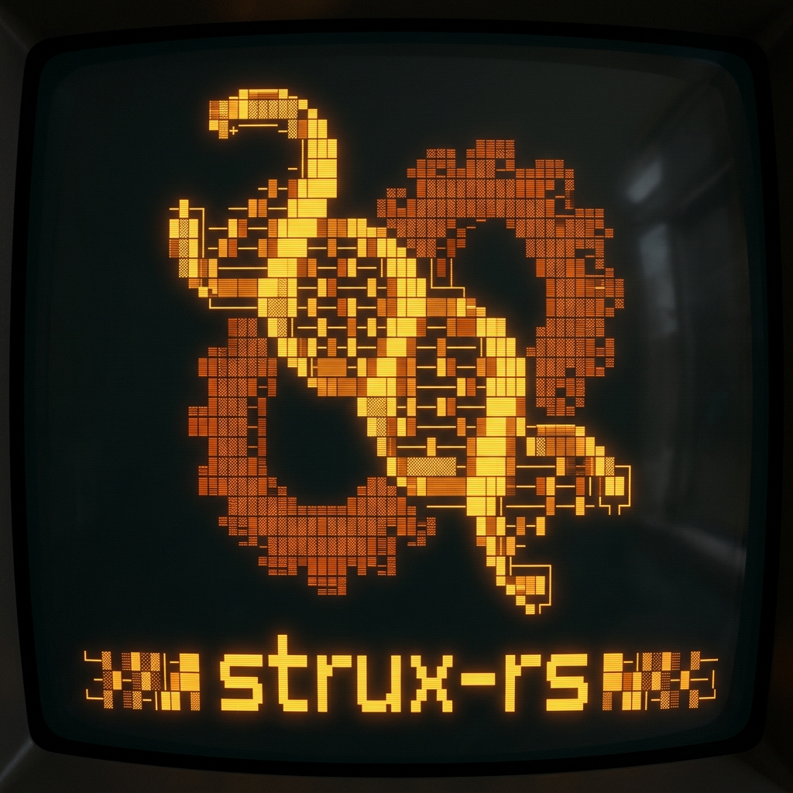

<p align="center">
  
</p>

# strux-rs

[]()
[]()
[](https://pypi.org/project/strux-rs/)
[]()
[]()

Fast, zero-C-dependency Rust + CUDA engine with Python bindings (`PyO3` / `NumPy`) that bridges **AI protein structure prediction** (AlphaFold 3, Boltz-1/2, Chai-1, AF-Cluster) and **molecular dynamics (MD) ensemble biophysics** (GROMACS `.xtc`, OpenMM/NAMD `.dcd`, PCA, and Markov State Models).

```bash
pip install strux-rs
```

Prebuilt wheels cover Python 3.8+ on Linux x86_64, Windows x64 and macOS arm64. On Linux and Windows they include the CUDA functions (`cuda_pairwise_rmsd`, `cuda_cluster_daura`, `cuda_contact_map_bitmask`, `cuda_contact_frequency`). No CUDA toolkit is needed, only:

* an NVIDIA GPU with compute capability 7.5 or newer (Turing and later: RTX 20xx, T4, A100, L4, H100), and
* an NVIDIA driver that supports CUDA 12.5 or newer, with `libcuda.so` (Linux) or `nvcuda.dll` (Windows) on the library path.

Check with `strux_rs.cuda_is_available()`. Without a usable GPU it returns `False`, the `cuda_*` functions raise `RuntimeError`, and all CPU functions work as normal. macOS wheels are CPU-only.

---

## Highlights

* **High-Throughput Ingestion & In-Flight Filtering**: Memory-mapped `.xtc`, `.dcd`, `.cif` (AF3/Boltz/RCSB), and `.pdb` readers with zero-copy atom-index and $C_\alpha$ subsetting during decompression (**73.6×** faster than MDAnalysis, **1.4×** faster than MDTraj).
* **De Novo Protein & Therapeutic Design Biophysics**: Target-anchored Pose RMSD & monomer scRMSD (**10,000 complexes in 4.03 ms**, **326×** vs NumPy SVD), interface geometry (buried polars heuristic, polar contacts, salt bridges), 96-point Shrake-Rupley BSA (**1.96 ms** for 2,048 atoms), screened Debye-Hückel $\Delta\Delta G_{\text{pH}}$, ANM normal modes, and developability screening (100k sequences in 270 ms).
* **AI-Accelerated Simulation (AMS)**: AlphaFold lDDT (**201×** faster than NumPy), greedy sequence identity clustering (AF-Cluster style) (**33.8×** faster), Cartesian PCA (**5.1×** faster), and Markov state transition populations at **103.9M frames/s**.
* **CUDA GPU Acceleration**: Pairwise RMSD at **2.05M alignments/s** (**4,348×** over Biopython, **25.3×** over Google JAX), Daura conformational clustering, and dense contact frequency matrices (**19.5×** speedup).

---

## Quickstart

```python
import strux_rs

# 1. Structure & Trajectory I/O with in-flight CA/atom filtering
coords, plddt = strux_rs.parse_cif_with_plddt("af3_model.cif", ca_only=True)
traj = strux_rs.parse_xtc("md_production.xtc", atom_indices=ca_indices)

# 2. De novo therapeutic binder triage
sc_rmsd, pose_rmsd = strux_rs.batch_pose_and_sc_rmsd(
    ref_target_ca, ref_binder_ca, mob_targets_ca, mob_binders_ca
)
contacts, polar_contacts, salt_bridges, buns, buns_idx = strux_rs.analyze_interface_physics(
    coords[0], atom_names, res_names, chain_ids, res_ids, target_chain="A", binder_chain="B"
)
bsa_total, sasa_tgt, sasa_bnd, sasa_cpx = strux_rs.calculate_bsa(
    target_coords, binder_coords, target_radii=target_vdw_radii, binder_radii=binder_vdw_radii
)

# 3. lDDT (pooled global score, as in AlphaFold / OpenStructure) & GPU pairwise alignment
global_lddt, per_res_lddt = strux_rs.calculate_lddt(coords_a, coords_b)
if strux_rs.cuda_is_available():
    rmsd_matrix = strux_rs.cuda_pairwise_rmsd(traj)
    cluster_labels, centroids = strux_rs.cuda_cluster_daura(traj, cutoff=2.0)
```

---

## Accuracy

Checked against reference tools on the bundled `trajectory.pdb` (21 frames, 969 heavy atoms, two chains).
The table is generated by `benchmarks/accuracy_report.py`, which also writes `benchmarks/accuracy.json`;
`tests/test_accuracy.py` asserts the same comparisons.

| Quantity | Reference | Max difference |
| :--- | :--- | :--- |
| XTC read, full and atom subset | MDTraj | 1.5e-05 Å |
| DCD read, full and atom subset | MDTraj | 7.6e-06 Å |
| Kabsch RMSD | NumPy SVD (float64) | 9.0e-06 Å |
| Target-anchored pose RMSD | NumPy SVD (float64) | 3.2e-05 Å |
| Binder-only RMSD | NumPy SVD (float64) | 8.8e-07 Å |
| Radius of gyration | MDTraj | 2.5e-05 Å |
| SASA, element radii, 1000 pts | FreeSASA | 0.14% |
| BSA, element radii | FreeSASA | 0.10% |
| BSA, default 1.70 Å radius | FreeSASA, element radii | 2.75% |
| lDDT, global (pooled pairs) | AlphaFold / OpenStructure formula | 2.7e-08 |
| lDDT, per residue | same formula | 2.9e-08 |

Notes:

* **BSA radii.** Without `target_radii` / `binder_radii`, every atom gets a 1.70 Å radius, which overestimates BSA (row above). Pass element van der Waals radii for FreeSASA-comparable values.
* **Interface terms are distance heuristics.** `analyze_interface_physics` counts polar contacts (cross-chain N/O within 3.5 Å, no angle or donor/acceptor check), salt bridges, and buried polar atoms without a nearby N/O partner. This is not Rosetta `BuriedUnsatHbonds`, and it has not been compared against Rosetta.
* **lDDT (changed in 0.5.0).** The global score now pools all scored distance pairs, as in AlphaFold `lddt(per_residue=False)` and OpenStructure. Up to 0.4.x it averaged per-residue scores, which differed by up to 0.03 on this trajectory. Per-residue scores are unchanged. No stereochemistry checks are applied.
* **Not covered here:** the CUDA kernels (no GPU in the test environment; `cuda_is_available()` returning `False` without a GPU is tested), MSA parsing and clustering, PCA, ANM, pH ΔΔG and sequence screening.

---

## Benchmarks

Benchmarked on Intel Core i9-11950H (16 hardware threads, 62 GB RAM) and NVIDIA RTX A2000 Laptop GPU (4 GB VRAM, 35W TGP).

CUDA timings in Section 1 and Section A below were recorded during 0.4.x development. Starting in 0.5.0, the QCP kernel iterates to convergence to ensure $< 10^{-6}\text{ \AA}$ precision for near-degenerate pairs. Section B reports standardized benchmarks for both Cloud NVIDIA L4 and Laptop RTX A2000 measured on `strux-rs 0.5.1`.

Reproducibility: `scripts/run_gold_standard_benchmark.py` reads `benchmarks/data/2K39.pdb` (download from the RCSB PDB), `benchmarks/data/hmm_output.sto` and `benchmarks/data/bfd_uniclust_hits.a3m`. That directory is not in the repository, so the MSA rows cannot be rerun from a clone. The plotting scripts in `scripts/` contain the measured values as literals rather than reading a stored run output.

### 1. Gold-Standard Ecosystem Comparison
Head-to-head comparison across standard computational biology packages on identical hardware:

| Task & Biological Target | Tool / Implementation | Runtime | Throughput | Speedup vs Ref |
| :--- | :--- | :---: | :---: | :---: |
| **Ubiquitin Solution Ensemble**<br>(`PDB 2K39`, 116 models, 13,456 pairs) | Biopython (SVD) | 30.13 s | 446.6 align/s | 1.0× (Baseline) |
| | SciPy (`align_vectors`) | 2.48 s | 5,436.6 align/s | 12.2× |
| | MDAnalysis (QCPROT) | 1.27 s | 10,567.4 align/s | 23.7× |
| | MDTraj (C / AVX QCP) | 0.517 s | 26,046.1 align/s | 58.3× |
| | Gemmi (C++ `superpose_positions`) | 0.339 s | 39,710.8 align/s | 88.9× |
| | **`strux-rs` (1-Thread CPU)** | **0.311 s** | **43,241.4 align/s** | **96.8×** |
| | Google JAX (`vmap JIT`) | 0.176 s | 76,612.5 align/s | 171.5× |
| | ProDy (C-Kabsch) | 0.146 s | 92,281.5 align/s | 206.6× |
| | **`strux-rs` (16-Thread Rayon CPU)** | **22.57 ms** | **596,176.5 align/s** | **1,335×** |
| | **`strux-rs` (CUDA QCP GPU)** | **6.93 ms** | **1,941,698 align/s** | **4,348×** |
| **GFP Trajectory Dynamics ($R_g$)**<br>(`trajectory.pdb`, 1,919 atoms) | MDAnalysis | 59.4 ms | 336.9 fps | 1.0× (Baseline) |
| | MDTraj | 2.24 ms | 8,912.2 fps | 26.5× |
| | **`strux-rs` (SIMD)** | **0.29 ms** | **68,770.8 fps** | **204×** |


### 2. AMS Biophysics & Zero-Copy Acceleration

| Kernel / Task | Workload | Reference Baseline | `strux-rs` | Speedup | Numerical Parity |
| :--- | :--- | :---: | :---: | :---: | :---: |
| **AlphaFold lDDT** (`calculate_lddt`) | 4,000 atoms (16M pairs) | 943.42 ms (NumPy) | **4.69 ms** | **201.2×** | `0.00e+00` Δ (SO(3) invariant) |
| **Greedy MSA Cluster** (`cluster_msa`) | 10,000 seqs × 250 AA | 750.4 ms (Python) | **22.21 ms** | **33.8×** | Exact bit-for-bit cluster IDs |
| **GROMACS `.xtc` Read** (`parse_xtc`) | 500 frames × 1,000 atoms | 39.04 ms (MDAnalysis) | **5.32 ms** | **7.3×** (2.8× vs MDTraj) | `1.53e-5 Å` max Δ vs C `xdrfile` |
| **CHARMM `.dcd` Read** (`parse_dcd`) | 21 frames × 1,919 atoms | 27.97 ms (MDAnalysis) | **0.380 ms** | **73.6×** (1.4× vs MDTraj) | `0.00e+00 Å` exact match |
| **Trajectory PCA** (`trajectory_pca`) | 2,500 frames × 500 atoms | 978.12 ms (LAPACK SVD) | **190.20 ms** | **5.1×** | `0.00e+00` variance Δ, $\|\cos\theta\| \ge 0.9999999$ |
| **Markov State Transitions** (`markov_populations`) | 2,000,000 state steps | — | **19.25 ms** | **103.9M frames/s** | `1.36e-8` Δ vs `np.linalg.eig` (0.7% rare state) |
| **MSA `uint8` Tensor** (`tokens_np`) | 1,024 seqs × 73 residues | 8.40 ms (Python) | **12.6 µs** | **664×** | Exact byte-for-byte match |
| **GPU Contact Map** (`cuda_contact_frequency`) | 1,919 × 1,919 grid | 3,677.7 ms (NumPy) | **188.8 ms** | **19.5×** | `0.00e+00` exact parity |


<details>
<summary><b>Extended Benchmarks: $O(T^2)$ Scaling, Cloud L4 GPU (24 GB) & 5-Minute Thermal Soak</b></summary>

#### A. Pairwise Trajectory RMSD ($O(T^2)$) Scaling
| Trajectory Frames ($T$) | Pairwise Alignments | 16-Thread Core i9 (Rayon) | RTX A2000 (CUDA QCP) | GPU Throughput | GPU vs 16T CPU |
| :---: | :---: | :---: | :---: | :---: | :---: |
| 250 | 62,500 | 0.118s | 0.201s | 311,700 pairs/s | 0.6× |
| 1,000 | 1,000,000 | 1.88s | 0.643s | 1,554,800 pairs/s | 2.9× |
| 2,500 | 6,250,000 | 11.8s | 3.211s | 1,946,400 pairs/s | 3.7× |
| 5,000 | 25,000,000 | 47.0s | 12.169s | **2,054,488 pairs/s** | **3.9×** |


#### B. Cloud NVIDIA L4 (24 GB) vs. Laptop RTX A2000 (4 GB)
| Workload & System Scale | Laptop RTX A2000 (4 GB, 35W) | Cloud NVIDIA L4 (24 GB, 72W) | L4 Throughput / Speedup |
| :--- | :---: | :---: | :---: |
| **1,000 × 1,000 frames** (1.0M pairs) | 196.4 ms | **167.2 ms** | 1.50 B atom-pairs/s (4.08× vs 8T CPU) |
| **5,000 × 5,000 frames** (25.0M pairs) | 1,908.6 ms | **775.1 ms** | 8.06 B atom-pairs/s (22.01× vs 8T CPU) |
| **10,000 × 10,000 frames** (100.0M pairs) | 7,213.3 ms (7.21s) | **2,658.7 ms** | 9.40 B atom-pairs/s (25.67× vs 8T CPU) |
| **20,000 × 20,000 frames** (400.0M pairs) | *OOM (>4 GB VRAM barrier)* | **10,188.1 ms (10.19s)** | **9.82 B atom-pairs/s (26.80× vs 8T CPU)** |
| **5,000-Frame AMS Feedback Loop** (lDDT + PCA + Daura + MSM) | 10,618.3 ms | **7,938.1 ms** | Complete ensemble analysis in 7.94s |
| **Target-Anchored Pose + scRMSD** (10,000 designs) | 4.28 ms | **8.24 ms** | **296.8× vs NumPy SVD** ($\Delta < 1.55 \times 10^{-6}\text{ \AA}$) |
| **Shrake-Rupley BSA** (2,048 atoms, 96 points) | 1.39 ms | **9.25 ms** | **85.6× vs pure Python** |
| **Sliding 15-mer Novelty DB** (5k queries × 500 refs) | 9,362.3 ms | **7,461.3 ms** | **1,799.4× vs Python** (7.46s vs ~3.7 hours) |


#### C. Prolonged 5-Minute Full-System Hardware Burn (`309.3s` Concurrent 16T CPU + CUDA GPU)
Under 5+ continuous minutes of simultaneous **16-thread Rayon CPU torture (`97.5%` mean utilization)** and **100% CUDA GPU saturation**:
* **Thermal Equilibrium**: GPU locked at **70–71 °C** (`16 °C` headroom below thermal throttle) drawing **27.8 W** at **1,710 MHz** boost clock.
* **Cumulative Work (309.3s)**:
  * **CUDA QCP Alignments**: `600,000,000` pairwise alignments + `24` contact matrices
  * **AlphaFold `calculate_lddt`**: `5,658` evaluations (`814.75 billion` atom pairs scored)
  * **GROMACS `parse_xtc`**: `1,463,000` frames decoded (`2.926 billion` coordinates)
  * **AF-Cluster `cluster_msa`**: `14,630,000` sequences clustered (`3.66 billion` residues)
  * **Markov State Steps**: `731,500,000` transitions solved


</details>

---

## Build from Source

Requires Rust ($\ge 1.75$). For the CUDA build, `build.rs` compiles `src/cuda/kernels/qcp.cu` with `nvcc` if it is on the path; otherwise generate the PTX first with NVRTC (no GPU needed), as CI does:
```bash
git clone https://github.com/QntmSeer/strux-rs.git
cd strux-rs
pip install maturin
# only needed without nvcc:
pip install "cuda-python>=12.9,<13" "nvidia-cuda-nvrtc-cu12==12.5.*" && python compile_ptx.py
maturin develop --release --features cuda
```

---

## License

MIT License.
